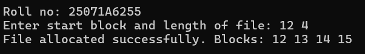
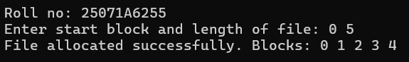
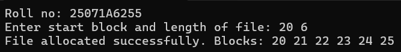
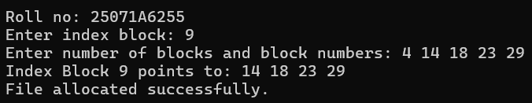
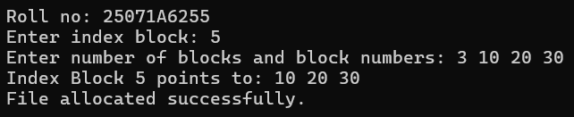
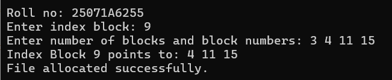
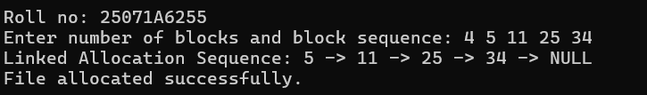
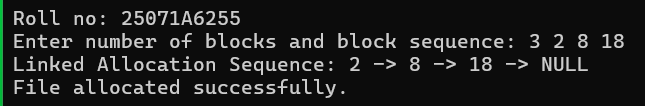
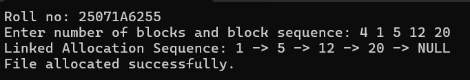

# Experiment 10 — File Allocation Strategies

**Date:** 24-09-2026  
**Roll No.:** 25071A6255

## Sequential Allocation

[`file_sequential.c`](src/file_sequential.c)

## Indexed Allocation

[`file_indexed.c`](src/file_indexed.c)

## Linked Allocation

[`file_linked.c`](src/file_linked.c)

